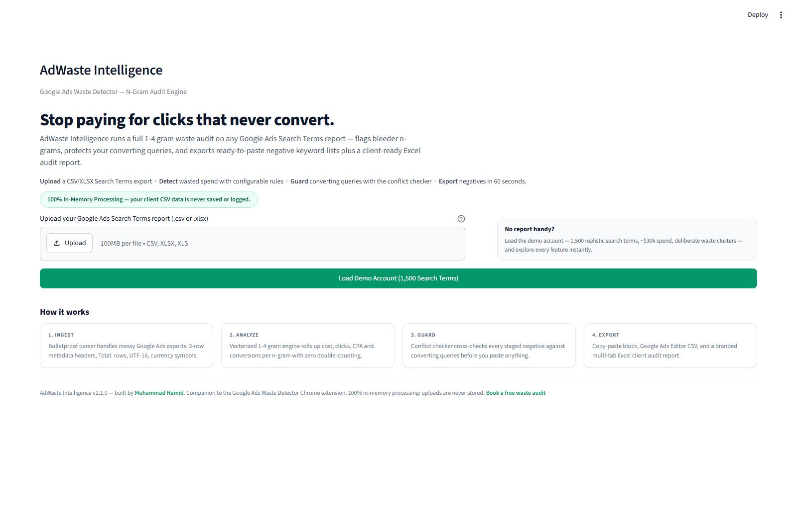
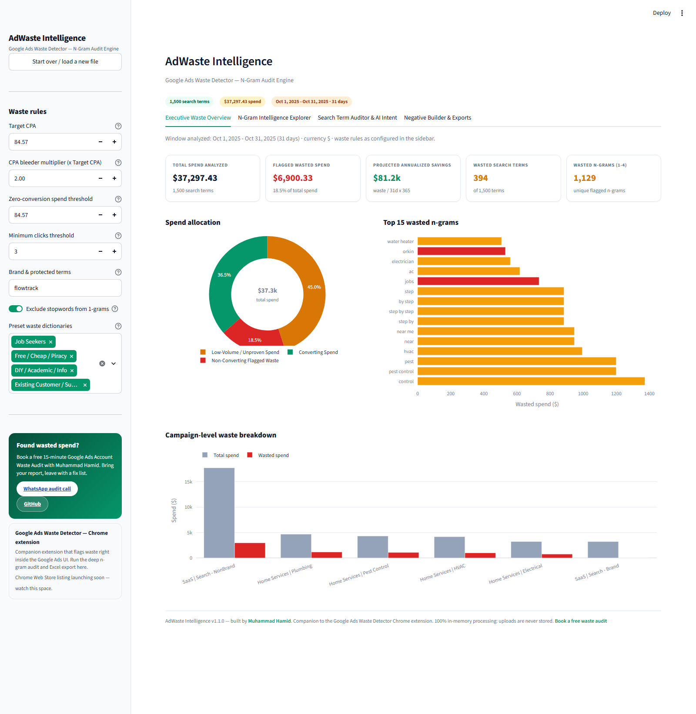
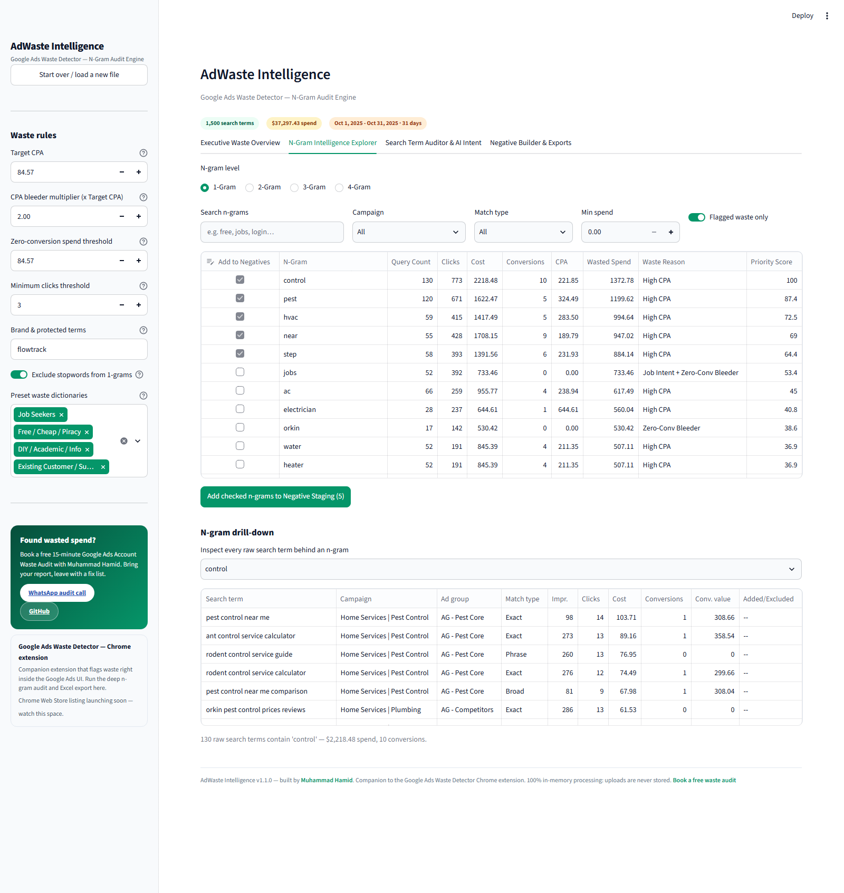
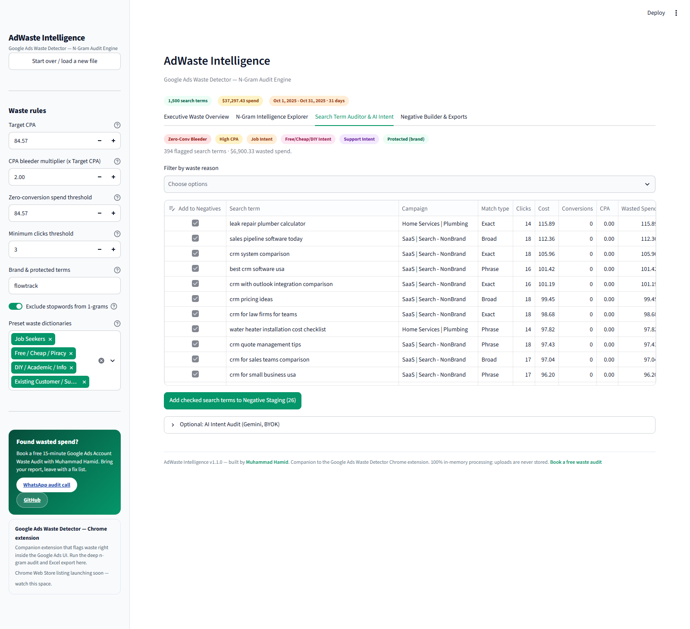
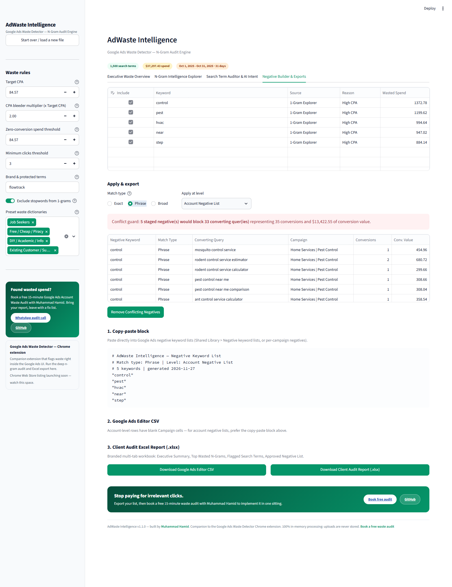

# AdWaste Intelligence

**Google Ads Waste Detector — N-Gram Audit Engine**

[](https://github.com/hamids-ai-automations/adwaste-intelligence/actions/workflows/ci.yml)
[](https://www.python.org/downloads/)
[](https://streamlit.io)
[](LICENSE)

> Companion web SaaS to the **Google Ads Waste Detector** Chrome extension.
> Upload any Google Ads Search Terms report (`.csv` or `.xlsx`) — or load the
> 1,500-term demo account — to run a full 1–4 gram waste audit, block conflicting
> negatives before they harm converting queries, and export ready-to-paste lists
> and client-ready Excel audit workbooks in under 60 seconds.
>
> **Privacy-first: 100% in-memory processing. Client CSV data is never written to disk, stored, or logged.**

---

## Status

| | |
|---|---|
| **Repository** | [hamids-ai-automations/adwaste-intelligence](https://github.com/hamids-ai-automations/adwaste-intelligence) — public |
| **CI** | `.github/workflows/ci.yml` runs `ruff check`, `pytest` (with `src/` coverage), headless `AppTest` smoke (`scripts/smoke_pages.py`), committed-secrets guard, `pip-audit`, and `gitleaks` across Python 3.11 & 3.12 |
| **Hosted demo** | Target URL: `https://adwaste-intelligence.streamlit.app` — **pending Streamlit Community Cloud interactive OAuth link** (see [Deployment status](DEPLOYMENT_STATUS.md) and [Deploy on Streamlit Community Cloud](#deploy-on-streamlit-community-cloud)) |
| **Local run** | Fully verified with demo mode ($37,297.43 spend, 18.5% flagged waste, $81.2k projected annual savings) and messy Google Ads CSV/XLSX ingestion |

---

## Table of Contents

- [What it does](#what-it-does)
- [Screenshots](#screenshots)
- [Quickstart (local)](#quickstart-local)
- [Quality checks & testing](#quality-checks--testing)
- [Deploy on Streamlit Community Cloud](#deploy-on-streamlit-community-cloud)
- [Project structure & architecture](#project-structure--architecture)
- [How wasted spend is calculated](#how-wasted-spend-is-calculated)
- [Privacy & security](#privacy--security)
- [Documentation](#documentation)
- [Author](#author)
- [License](#license)

---

## What it does

| | Feature | Why it matters |
|---|---|---|
| 1 | **Bulletproof Google Ads ingestion** | Handles 2-row metadata headers, `Total:` summary rows, UTF-16, tab/semicolon/comma delimiters, `$` / `AED` / `PKR` / `€` / `£` / `INR` currencies, `--` and `< 10%` placeholders, ragged rows, and variant column names. Falls back to a manual column-mapping UI if a required column is missing. |
| 2 | **One-click demo account** | Deterministic 1,500-term B2B SaaS + Home Services account (`$37,297.43` spend, deliberate waste clusters) so visitors experience every workflow in 2 seconds with zero file upload needed. |
| 3 | **Vectorized 1–4 gram engine** | Rolls up cost, impressions, clicks, conversions, CTR, CPC, Conv. Rate, CPA, and ROAS per n-gram with **zero intra-query double-counting**. Includes a 50,000-row performance benchmark guard in `tests/`. |
| 4 | **Configurable waste rules** | Auto-initialized Target CPA, CPA bleeder multiplier, zero-conversion spend threshold, min-clicks gating, brand-term whitelist protection, bundled stopword exclusion (1-grams only), and 4 preset negative-intent dictionaries (Job Seekers, Free/Cheap/Piracy, DIY/Academic, Existing Customer/Support). |
| 5 | **Executive dashboard** | 5 KPI cards (Total Spend Analyzed, Flagged Wasted Spend, Projected Annualized Savings, Wasted Search Terms, Wasted N-Grams), spend-allocation donut, top-15 wasted n-grams bar chart, and campaign-level waste breakdown. |
| 6 | **N-gram explorer with drill-down** | Filter by n-gram level (1–4), campaign, match type, flagged-only, min spend, and text search; stage rows via checkboxes; inspect every raw search term behind any n-gram. |
| 7 | **Conflict guard (key differentiator)** | Cross-checks every staged negative keyword (Exact / Phrase / Broad match semantics) against all **converting** search terms, quantifies blocked conversions and conversion value, and strips conflicts with one click. |
| 8 | **3 export channels** | Copy-paste block for Google Ads UI, Google Ads Editor CSV (`Campaign, Ad group, Keyword, Criterion Type`), and a formatted multi-tab Excel client audit workbook (`.xlsx` built in-memory). |
| 9 | **Optional AI intent audit (BYOK)** | Supply a `GEMINI_API_KEY` (runtime input, env var, or `st.secrets`) to classify up to 100 top non-converting terms into High Commercial Intent / Informational / Competitor / Job / Irrelevant. Works 100% offline/free without a key. |

---

## Screenshots

Captured from a local run (`streamlit run app.py`, headless Chromium 1600px wide, light theme) using the built-in **1,500-term Demo Account**.

### 1 · Landing & Privacy-First Uploader


### 2 · Tab 1 — Executive Waste Overview


### 3 · Tab 2 — N-Gram Intelligence Explorer & Drill-Down


### 4 · Tab 3 — Search Term Auditor & Optional Gemini AI Intent


### 5 · Tab 4 — Negative Builder, Conflict Guard & Exports


---

## Quickstart (local)

Requirements: **Python 3.11+**

```bash
git clone https://github.com/hamids-ai-automations/adwaste-intelligence.git
cd adwaste-intelligence

python -m venv .venv
# Windows
.venv\Scripts\activate
# macOS / Linux
source .venv/bin/activate

pip install -r requirements.txt
streamlit run app.py
```

Open `http://localhost:8501` and click **Load Demo Account (1,500 Search Terms)** — no CSV export required.

---

## Quality checks & testing

Install development tooling and run the exact gates enforced by CI:

```bash
pip install -r requirements-dev.txt
ruff check .
pytest --cov=src --cov-report=term-missing
python scripts/smoke_pages.py
```

The test suite covers messy Google Ads CSVs & XLSX roundtrips (metadata rows, ragged totals, UTF-16, currencies, placeholders, column aliases, manual mapping fallback), 1–4 gram aggregation invariants (intra-query deduplication, stopword handling, drill-down), waste rules & brand whitelist protection, match-type conflict detection, copy-paste/CSV/Excel exports, mocked Gemini audit parsing, UI helpers/charts, headless `AppTest` integration, and a 50,000-row performance benchmark.

---

## Deploy on Streamlit Community Cloud

1. Open [share.streamlit.io](https://share.streamlit.io) and sign in with GitHub.
2. Click **New app** → **From existing repo** → select `hamids-ai-automations/adwaste-intelligence`.
3. Set branch to `main`, **Main file path** to **`app.py`**, and Python to **3.11** or **3.12**.
4. Click **Deploy** — `requirements.txt` needs no `packages.txt` OS binaries.

### Optional secrets

Copy `.streamlit/secrets.toml.example` to `.streamlit/secrets.toml` locally (git-ignored) or add keys under **App settings → Secrets** in Streamlit Community Cloud:

```toml
GEMINI_API_KEY = "your-key"              # enables optional BYOK AI intent audit
CHROME_EXTENSION_URL = "https://..."     # live Chrome Web Store listing URL
```

Resolution order: `os.environ` → `st.secrets` → disabled/placeholder. Both are optional; the full app works without them.

---

## Project structure & architecture

```text
adwaste-intelligence/
├── app.py                              # Main Streamlit entry point, 4-tab UI, session state
├── pyproject.toml                      # Ruff, pytest, and coverage configuration
├── requirements.txt                    # Streamlit Community Cloud runtime dependencies
├── requirements-dev.txt                # Dev/CI tools (pytest, pytest-cov, ruff)
├── .streamlit/
│   ├── config.toml                     # Branded light theme, 100 MB upload cap, telemetry off
│   └── secrets.toml.example            # Documented template for optional secrets
├── .github/
│   ├── workflows/ci.yml                # Lint, pytest + coverage, AppTest smoke, pip-audit, gitleaks
│   ├── dependabot.yml                  # Automated pip & GitHub Actions dependency updates
│   ├── ISSUE_TEMPLATE/                 # Structured bug report & feature request forms
│   ├── PULL_REQUEST_TEMPLATE.md
│   └── CODEOWNERS
├── assets/screenshots/                 # Verified UI captures used in this README
├── docs/ARCHITECTURE.md                # Layered architecture, data flow, and rule model
├── scripts/smoke_pages.py              # Headless AppTest landing/demo/staging verification
├── src/
│   ├── constants.py                    # Bundled stopwords & preset PPC waste dictionaries
│   ├── ingestion.py                    # Bulletproof CSV/XLSX parser & cleaner
│   ├── sample_data.py                  # Deterministic 1,500-row demo dataset generator
│   ├── ngram_engine.py                 # Vectorized 1-4 gram aggregation
│   ├── waste_detector.py               # Waste rules, conflict guard, optional Gemini audit
│   ├── exporter.py                     # Copy-paste, Google Ads Editor CSV, Excel workbook
│   └── ui_components.py                # KPI cards, Plotly charts, privacy & CTA banners
└── tests/                              # Unit, integration, and 50k-row performance tests
```

See [`docs/ARCHITECTURE.md`](docs/ARCHITECTURE.md) for the full data-flow diagram and invariants.

---

## How wasted spend is calculated

A search term or n-gram is flagged when any rule matches **and** it is not protected by the brand whitelist:

| Rule | Condition | Wasted spend counted |
|---|---|---|
| **Zero-Conv Bleeder** | `Conversions = 0` AND `Cost ≥ threshold` AND `Clicks ≥ min` | 100% of cost |
| **High CPA** | `CPA ≥ Target CPA × multiplier` | Excess cost above Target-CPA budget (`cost − target_cpa × conversions`) |
| **Preset Intent** | Matches an enabled dictionary AND `Conversions = 0` | 100% of cost |

**Projected Annualized Savings** = `flagged wasted spend ÷ days-in-report × 365` (date range parsed from the export header; 30 days assumed when absent).

The **Priority Score (0–100)** scales flagged rows relative to the highest wasted-spend item so the largest budget leaks surface first.

---

## Privacy & security

- All parsing, n-gram aggregation, conflict checks, and report generation run **100% in-memory** per session.
- Uploaded files are never written to disk, logged, or persisted across sessions.
- The optional Gemini intent audit transmits only the selected search-term strings using your own API key.
- See [`SECURITY.md`](SECURITY.md) for vulnerability reporting and security design guarantees.

---

## Documentation

| Document | Contents |
|---|---|
| [`docs/ARCHITECTURE.md`](docs/ARCHITECTURE.md) | Module design, data flow, rule logic, and secret resolution |
| [`DEPLOYMENT_STATUS.md`](DEPLOYMENT_STATUS.md) | Verified local checks, CI status, and Streamlit Cloud runbook |
| [`SPEC.md`](SPEC.md) | Original product specification, roadmap, and launch checklist |
| [`CONTRIBUTING.md`](CONTRIBUTING.md) | Local dev setup, quality gates, and contribution guidelines |
| [`SECURITY.md`](SECURITY.md) | Privacy architecture and security disclosure policy |
| [`CHANGELOG.md`](CHANGELOG.md) | Release notes (`v1.0.0`, `v1.1.0`) |

---

## Author

**Muhammad Hamid** — AI Automation Engineer · Google Ads Waste Elimination · Python & Streamlit Developer

- Portfolio: [marvis.web.app](https://marvis.web.app/)
- GitHub: [github.com/hamids-ai-automations](https://github.com/hamids-ai-automations)
- WhatsApp (free 15-minute account waste audit): [wa.me/923167417135](https://wa.me/923167417135)

---

## License

[MIT](LICENSE) © 2026 Muhammad Hamid
